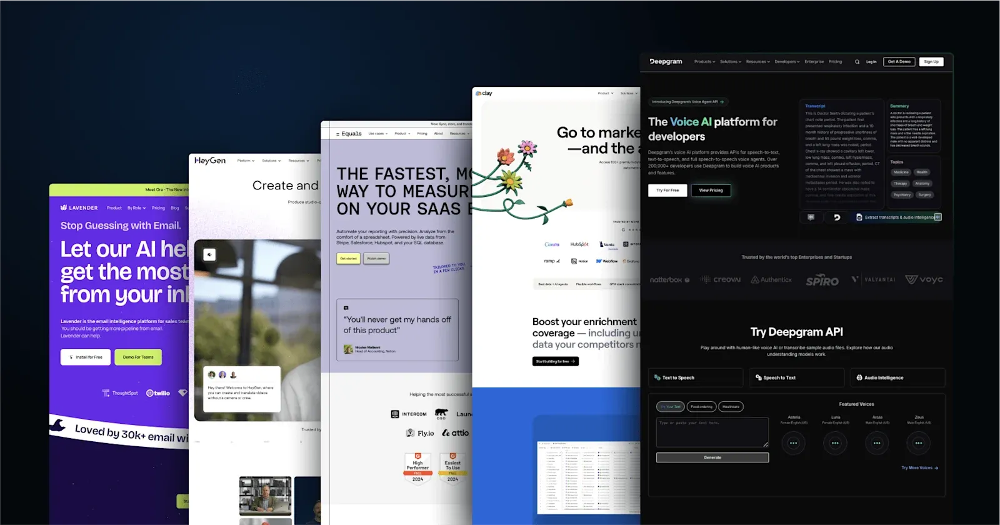
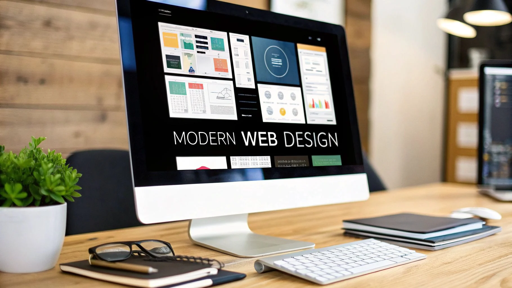
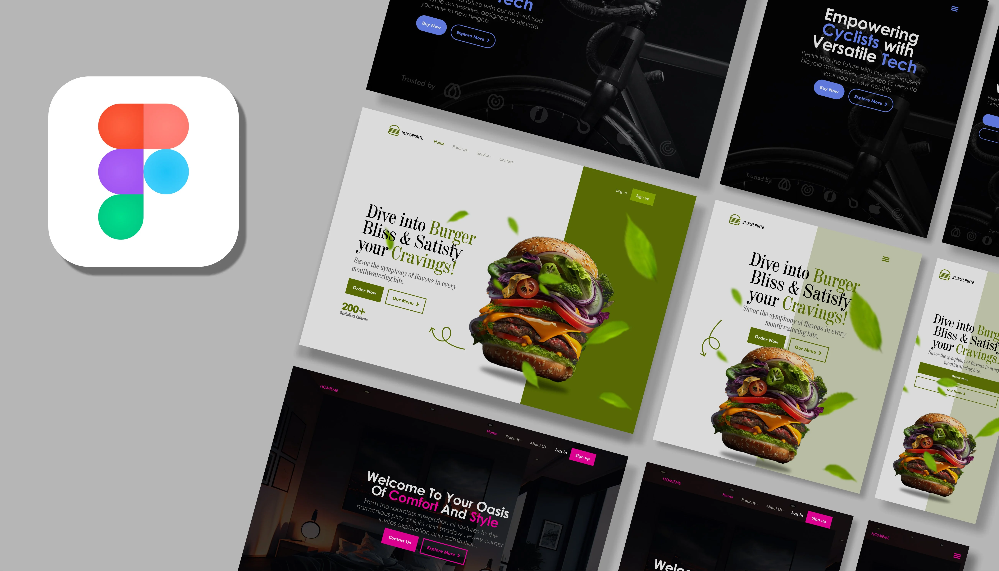

Startup Connect Design Document
Version 1.0
Date: January 08, 2026
Purpose: This standalone design document provides a clear, detailed blueprint for developers (or AI-assisted design tools) to create the Startup Connect website. It combines Apple-level minimalism (clean, spacious, premium feel) with Duolingo-inspired interactivity (subtle playfulness, motivational micro-interactions, and user delight) to create a "wow" experience that feels professional, empowering, and approachable for grassroots entrepreneurs.
The design prioritizes:

Instant trust and credibility
Zero learning curve (the AI co-pilot is the main interface)
Emotional connection ("This platform understands me")
Smooth, delightful performance across devices (especially mobile in India)

1. Design Philosophy & Core Principles
Tagline (Internal): "Empower Your Spark – Chat Your Way to Growth"
Core Principles:

Minimalism First – Ruthless reduction of visual noise (Apple influence)
Subtle Delight – Micro-interactions that reward and guide without overwhelming (Duolingo influence)
Empathy & Warmth – Professional yet human, never cold
Performance is Design – <2s load times, buttery-smooth 60fps animations
Accessibility – High contrast, large touch targets, voice-first readiness

2. Color Palette
Primary Palette (Light Mode – Default)

Color Name,Hex,RGB,Usage
Background,#FFFFFF,"255,255,255",Main background
Surface,#F8FAFC,"248,250,252","Cards, sections"
Primary,#0EA5E9,"14,165,233","Main CTAs, accents (bright sky blue)"
Primary Dark,#0369A1,"3,105,161","Hover, active states"
Secondary,#10B981,"16,185,129","Success, growth indicators"
Neutral,#64748B,"100,116,139",Secondary text
Text Primary,#0F172A,"15,23,42",Main body text
Text Secondary,#475569,"71,85,105","Subtitles, labels"
Accent Gold,#D97706,"217,119,6","Highlights, ""wow"" moments (sparing)"
Error,#EF4444,"239,68,68",Warnings

Color NameHexRGBUsageBackground#FFFFFF255,255,255Main backgroundSurface#F8FAFC248,250,252Cards, sectionsPrimary#0EA5E914,165,233Main CTAs, accents (bright sky blue)Primary Dark#0369A13,105,161Hover, active statesSecondary#10B98116,185,129Success, growth indicatorsNeutral#64748B100,116,139Secondary textText Primary#0F172A15,23,42Main body textText Secondary#47556971,85,105Subtitles, labelsAccent Gold#D97706217,119,6Highlights, "wow" moments (sparing)Error#EF4444239,68,68Warnings
Dark Mode Variant (Auto-detect or toggle)

Background: #0F172A
Surface: #1E293B
Primary: #38BDF8
Text Primary: #F1F5F9

Usage Rule: 80% neutral/white space, 15% primary/secondary, ≤5% accent gold for special moments (e.g., successful generation confetti).
Here are reference examples of the desired minimalist + approachable aesthetic:
Here are some visual inspirations for the clean, spacious startup homepage style we're aiming for:

3. Typography
Primary Font: Inter (sans-serif, highly legible, modern)
Fallback: system-ui, -apple-system, BlinkMacSystemFont, "Segoe UI", Roboto, sans-serif
Scale (Fluid – use clamp())

RoleFont Size (clamp)WeightLine HeightUsageHero Headingclamp(2.5rem, 6vw, 4.5rem)8001.1Main taglineSection Headingclamp(2rem, 4vw, 3rem)7001.2H1/H2Body Large1.25rem5001.6IntroductionsBody1.125rem4001.6Main contentSmall / Labels0.875rem5001.4Captions, metadata
Rules:

Max line length: 65–75 characters
High contrast (≥ 4.5:1)
Generous letter-spacing on headings (+0.5–1px)

4. Layout & Grid System
Base Grid: 12-column flexible grid (Tailwind or CSS Grid)
Breakpoints (Mobile-first):

sm: 640px
md: 768px
lg: 1024px
xl: 1280px
2xl: 1536px

Spacing Scale: 4px increments (4, 8, 12, 16, 20, 24, 32, 40, 48, 64, 80, 96, 128)
Container: Max-width 1280px, centered, with 1.5–2rem padding on sides (more on mobile)
Hero Section: Full viewport height (min-height: 90vh), centered content

5. Key Screens & Components
5.1 Landing Page – Hero Section
Goal: Instant "wow" + clear value proposition
Elements:

Full-bleed subtle gradient background (white → very light blue/green)
Large centered headline: "Turn Your Skills Into a Thriving Business"
Subheadline: "Just chat with your AI co-pilot – no complex tools required"
Pulsing floating chat bubble (primary color) with placeholder: "Hi! Tell me about your skill..."
Animated floating icons (hammer → graph, needle → storefront, laptop → rocket) morphing subtly
Two CTAs: "Start Chatting Free" (big primary button) + "Watch Demo" (outline)

Animation References (subtle morphing + float):
Here are examples of the kind of empowering, animated hero elements we want:
skillshare.comFigma UI/UX: Design a Website Hero Section with Prototype ...

5.2 Main Interface – AGUI Chat Screen
Layout: After sign-up → full-screen chat (like modern messengers)
Elements:

Minimal header with logo + user avatar + dark mode toggle
Chat bubbles: User right (neutral), AI left (primary accent border)
Floating voice mic (glows when listening)
Typing indicator with gentle pulse
Quick-reply chips appear contextually (e.g. "Generate Logo", "Find Partner")
Success animations: Soft confetti / checkmark bloom on completions

Inspiration (futuristic yet clean chat feel):
Here are reference visuals for the AI chat interface:
dreamstime.com1,596 Futuristic Cyber Digital Interface Message Stock Photos ...
Duolingo-style micro-interactions (progress, rewards):
Here are playful, motivational UI elements we want to subtly incorporate:
produxdesign.studioRole of UI/UX Design in Gamification, Exploring Duolingo's Success ...
5.3 Other Key Screens

Dashboard – Card-based: "Your Latest Assets", "Active Matches", "Market Insights" (interactive hover lift)
Asset Preview – Full-screen modal with download/share buttons + regenerate prompt
Matches Page – Tinder-like cards or grid with strength/weakness highlights
Generated Webpage Preview – Iframe embed with "Looks great! Publish later" overlay

6. Animations & Motion Guidelines
Library Recommendation: Framer Motion (React)
Principles: Natural, purposeful, short (200–600ms)
Easing: cubic-bezier(0.4, 0, 0.2, 1) – smooth start & end
Key Animations:

AnimationDurationTriggerDescriptionPage Fade In400msRoute changeopacity + slight y shiftChat Message Appear300msNew messageScale 0.95 → 1 + fadeButton Pulse2s loopHover on main CTASubtle scale 1.02 + shadow liftFloating Icons8–12sHero sectionGentle float + morph (SVG or Lottie)Success Celebration1.5sGeneration completeSoft confetti + scale bounceNavigation Redirect300msAI changes URLFade out → fade in + progress bar
Performance: Use will-change: transform, GPU acceleration, avoid layout thrashing.

7. Responsiveness & Accessibility
Mobile-First Approach:

Chat always full-width on mobile
Large touch targets (min 48×48px)
Voice input prominent

Accessibility Checklist:

WCAG 2.1 AA
Semantic HTML
ARIA labels on interactive elements
Keyboard navigation (chat input focus)
Screen reader friendly (logical flow)

8. Summary – The "Wow" Checklist
When users land on Startup Connect, they should feel:
☑ Instant professionalism & trust
☑ "This is made for someone like me"
☑ Subtle delight in every interaction
☑ Zero friction – the AI does the heavy lifting
☑ Empowered & excited to start chatting
This design document gives developers everything needed to translate the vision into a pixel-perfect, emotionally resonant experience.
Let's build something truly transformative!